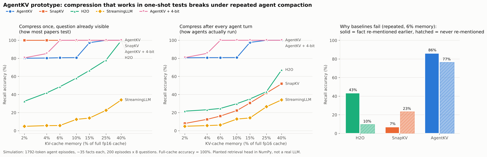

# AgentKV — prototype

**Question:** KV-cache compression methods are tested by compressing a long prompt *once*, usually with the question already visible. AI agents don't work that way. They run for many turns, and memory has to be compressed again and again before anyone knows what will be asked. Do existing methods survive that?

**Prototype answer (simulation):** No. SnapKV goes from **100% → 16%** recall at 6% memory once compaction is repeated, and H2O goes from 49% → 25%. An agent-aware policy that knows *what kind of text* each token came from (system prompt / user / assistant / tool output) holds at **81%**, and at **100%** when combined with 4-bit quantization at the same memory.



## What's in here

```
agentkv/
  episodes.py   synthetic multi-turn agent transcripts (typed tokens, facts, tool-log noise)
  cache.py      KV cache + one planted retrieval attention head, fake 4-bit quantization
  policies.py   Recent window, StreamingLLM, H2O, SnapKV, AgentKV (+ ablations)
  bench.py      single-shot vs repeated-compaction sweep over memory budgets
  plot.py       makes results/agentkv_results.png
real_model/
  agentkv_press.py   UNTESTED drop-in for NVIDIA KVPress on real HF models
results/
  results.json, agentkv_results.png
```

## Run it

Needs only Python 3 + NumPy + Matplotlib (CPU, ~4 minutes):

```bash
python -m agentkv.bench --episodes 200   # writes results/results.json
python -m agentkv.plot                   # writes results/agentkv_results.png
```

## Setup

Each episode is a 1,792-token agent transcript: a system prompt, then 12 turns of *user → assistant → tool output*. About 35 "facts" (key→value memories, e.g. "repo path = …") are scattered through it: 4 in the system prompt, 2 per user turn, and sometimes one buried in a 120-token tool log. Assistant turns re-mention some earlier facts, the way an agent thinks about them. At the end, 8 questions ask about random facts.

- **Single-shot:** read everything including the questions, compress once, then answer. This is the standard paper setup.
- **Repeated:** compress after every turn so the cache never exceeds the budget, then the questions arrive. This is the agent setup.

Memory budget = % of the full fp16 cache. The 4-bit run uses the same bytes, so it fits ~3.4× more tokens.

## Results

Recall accuracy (full cache = 100%):

| Policy | Single-shot @ 6% | Repeated @ 6% | Repeated @ 15% |
|---|---|---|---|
| Recent window | 3% | 3% | 11% |
| StreamingLLM | 6% | 6% | 14% |
| H2O | 49% | 25% | 35% |
| SnapKV | **100%** | **16%** | 31% |
| AgentKV: type prior only | 48% | 49% | 81% |
| AgentKV: addressability only | 3% | 2% | 100% |
| **AgentKV (type + addressability)** | 81% | **81%** | 98% |
| **AgentKV + 4-bit** | 100% | **100%** | 100% |

Why the baselines fail (repeated, 6% memory):

| Policy | Fact re-mentioned earlier | Never re-mentioned |
|---|---|---|
| H2O | 43% | 10% |
| SnapKV | 7% | 23% |
| AgentKV | 86% | 77% |

H2O keeps what has *already* been attended to, so facts nobody has looked at yet get evicted before the question arrives. SnapKV scores tokens by the last few queries, which in an agent loop are tool-log tokens, not the question. AgentKV doesn't depend on future queries, so repeated compaction doesn't hurt it.

**Where AgentKV still fails:** at 6% it keeps 100% of system and user facts but only 3% of facts buried in tool outputs. Its type prior assumes tool output is junk. That's the motivation for replacing the hand-set weights with a **learned scorer**, the core method work in the real project.

## Honest limitations

This is a mechanism sanity check, not evidence about real LLMs.

- **The model is a single planted attention head in NumPy, not a trained LLM.** Real models spread retrieval across many heads and layers.
- **I designed the episodes, so the structure (typed segments, facts vs. noise) favours a type-aware policy by construction.** The real test is whether real agent transcripts have exploitable structure.
- **The "addressability" signal (key norm) works only because of how the sim is built.** In real LLMs, key norm relates to attention very differently. `real_model/agentkv_press.py` uses a proper KVPress base scorer instead.
- **Baselines are simplified reimplementations, not the official code.**
- **Speed and memory are not measured.** Real speedups depend on serving-stack integration (vLLM, FlashAttention), which is phase 3 of the project.

## Next steps (maps to the 8-month plan)

1. Port the benchmark to real agent transcripts (SWE-bench, τ-bench, LongMemEval) with a 1–8B open model.
2. Run KVPress's built-in presses under repeated compaction, to confirm or refute the main finding on a real model.
3. Replace `TYPE_PRIOR` with a small learned scorer trained on which tokens later get retrieved.
4. Integrate into vLLM and measure real memory and throughput.

## References

- Devoto, Jeblick & Jégou (2025). *Expected Attention: KV Cache Compression by Estimating Attention from Future Queries Distribution.* arXiv:2510.00636 (KVPress)
- *Rethinking Key-Value Cache Compression Techniques for Large Language Model Serving* (2025). arXiv:2503.24000
- Colaco & Lahjouji (2026). *What to Keep, What to Forget: A Rate–Distortion View of Memory Compaction in LLMs and Agents.* arXiv:2607.08032
- Zhang et al. (2023). *H2O: Heavy-Hitter Oracle for Efficient Generative Inference of LLMs.* NeurIPS 2023
- Xiao et al. (2024). *Efficient Streaming Language Models with Attention Sinks.* ICLR 2024
- Li et al. (2024). *SnapKV: LLM Knows What You Are Looking for Before Generation.*
- Liu et al. (2024). *KIVI: A Tuning-Free Asymmetric 2bit Quantization for KV Cache.* ICML 2024
